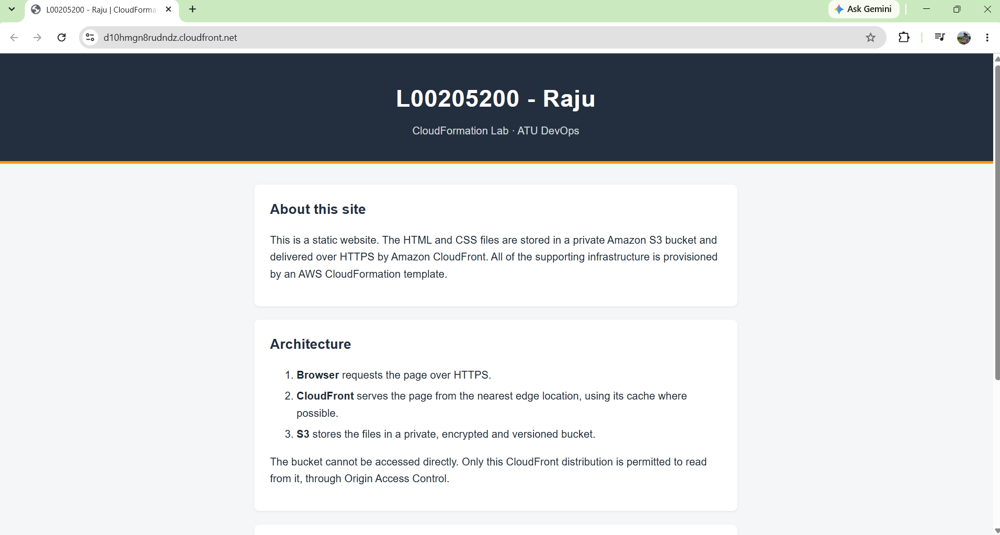
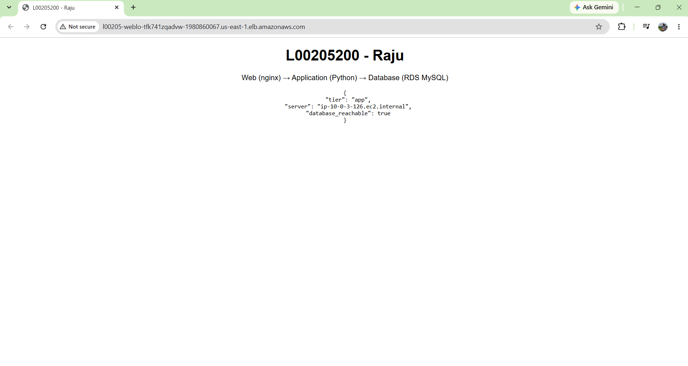
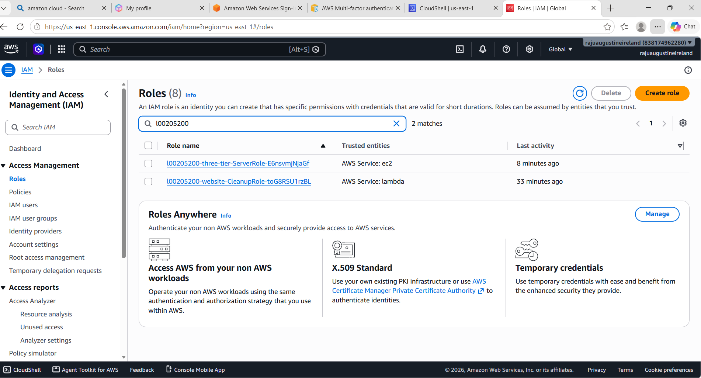
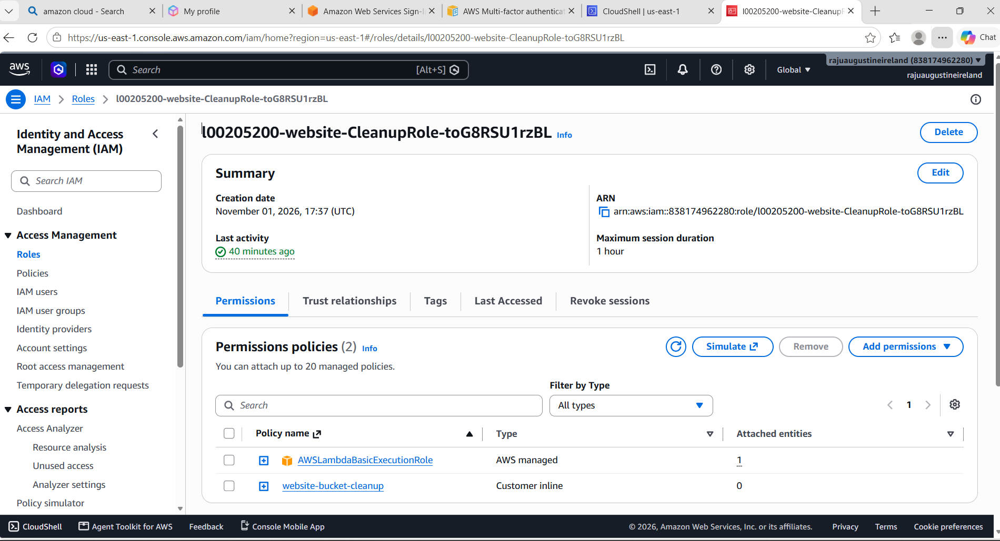
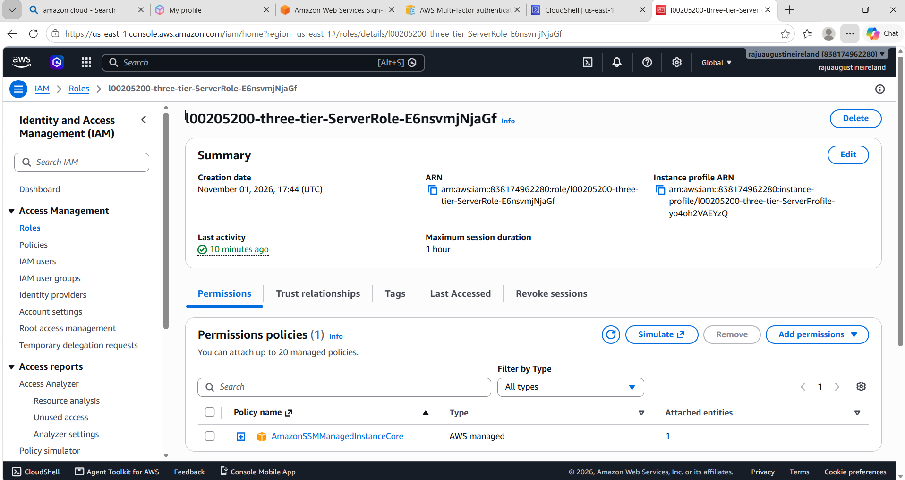
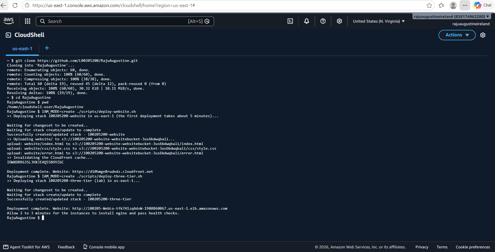
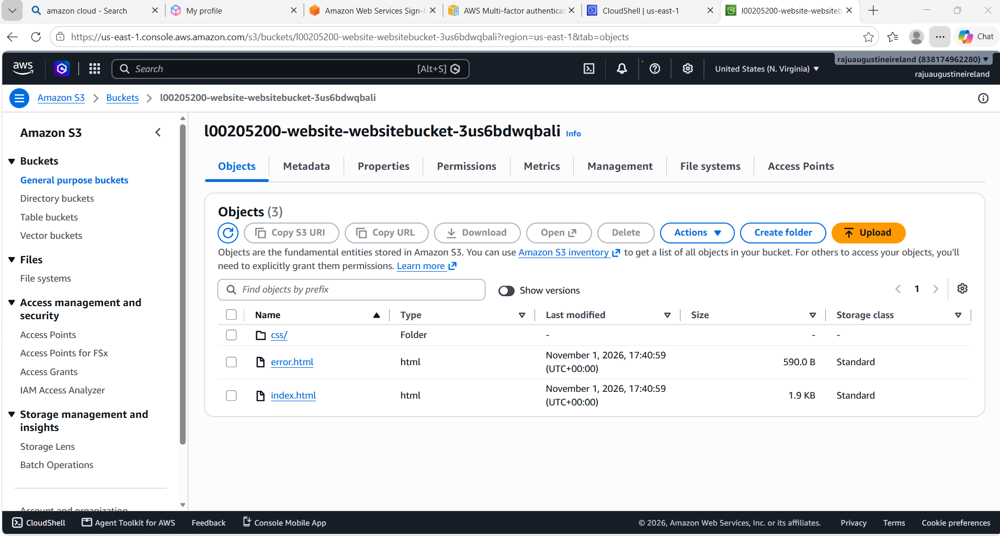
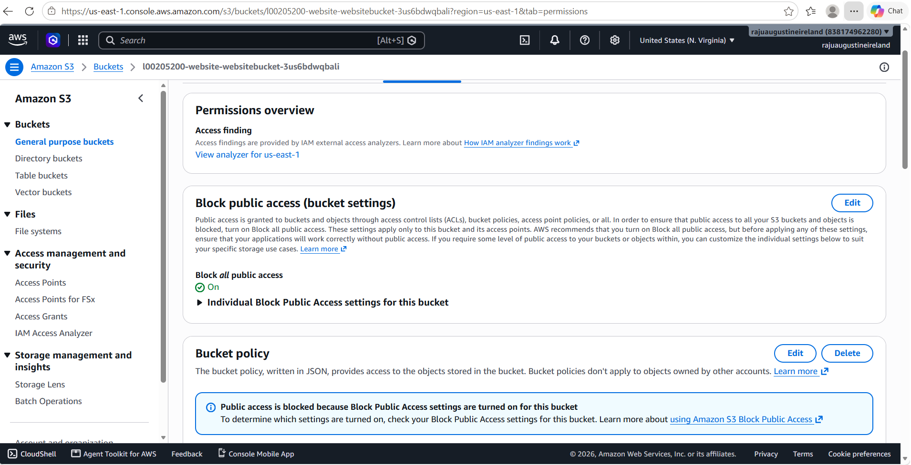

# CloudFormation Lab - L00205200 Raju

This repository contains my submission for the CloudFormation lab. It covers two parts:

- **Part A1a – `templates/01-static-website.yaml`:** a static website stored in Amazon S3 and delivered through Amazon CloudFront.
- **Part A1b – `templates/02-three-tier.yaml`:** a three-tier architecture with a web tier, an application tier and a database tier.

Both stacks were deployed and tested in my personal AWS account using AWS CloudShell in `us-east-1`. Screenshots of each test are in `docs/screenshots/` and are shown in the [Testing](#testing) section.

## Repository Structure

```
.github/workflows/validate.yml    Validation pipeline that runs on every pull request
templates/01-static-website.yaml  S3 bucket and CloudFront distribution (Part A1a)
templates/02-three-tier.yaml      VPC and the web, application and database tiers (Part A1b)
website/                          Static website content (HTML and CSS)
scripts/deploy-website.sh         Deploys the website stack and uploads website/
scripts/deploy-three-tier.sh      Deploys the three-tier stack
scripts/teardown.sh               Deletes both stacks
docs/screenshots/                 Evidence of successful deployment
```

## Part A1a - Static Website

### Overview

The page header displays my student number and name (L00205200 - Raju). The site content is kept in the `website/` folder. It is uploaded to an S3 bucket, and CloudFront acts as the public-facing web service.

Most tutorials make the bucket public and enable S3 static website hosting. This approach works, but it serves the site over HTTP only and allows anyone to read the bucket directly. I took a more secure approach:

- **Private bucket.** All public access is blocked, and only CloudFront can read from the bucket, through Origin Access Control (OAC).
- **HTTPS only.** CloudFront redirects HTTP requests to HTTPS. The AWS managed security headers policy is attached, which adds HSTS, X-Frame-Options and other protective headers.
- **Data protection.** The bucket has encryption and versioning enabled, and the bucket policy denies any request that is not made over HTTPS.

```
User --HTTPS--> CloudFront --(OAC)--> Private S3 bucket  <-- aws s3 sync website/
```

CloudFormation cannot upload files to a bucket on its own, so `scripts/deploy-website.sh` handles the full deployment in three steps:

1. Deploys the CloudFormation stack.
2. Uploads `website/` with `aws s3 sync`.
3. Invalidates the CloudFront cache so that changes are visible immediately.

Keeping the content in a separate folder means the HTML can be updated and redeployed without changing the template.

One problem I ran into is that CloudFormation won't delete an S3 bucket if there are still files in it. To fix this, I added a small Lambda function that empties the bucket automatically when the stack is deleted. This means I can remove everything with one command. I got the idea from the AWS page on Lambda and infrastructure as code that was linked in the brief.

### Deployment

```bash
./scripts/deploy-website.sh
```

In my personal AWS account I ran it with `IAM_MODE=create`, so the template created its own least-privilege role (see [IAM and Access Control](#iam-and-access-control)):

```bash
IAM_MODE=create ./scripts/deploy-website.sh
```

The first deployment takes about five minutes, mainly while CloudFront propagates. The script prints the website URL when it finishes.



## Part A1b - Three-Tier Architecture

### Network Layout

The template creates a VPC across two Availability Zones with three sets of subnets:

- **Public subnets:** the internet-facing load balancer and the NAT gateway.
- **Application subnets (private):** the web servers, the internal load balancer and the application servers.
- **Database subnets (private):** the RDS database. These subnets have no route to the internet.

Request flow:

```
Internet
  -> Public ALB (port 80)
  -> Web tier: nginx, Auto Scaling group
  -> Internal ALB (reachable only from the web tier)
  -> Application tier: Python API on port 8080, Auto Scaling group
  -> Database tier: RDS MySQL 8.4 on port 3306
```

To check that all three tiers actually work together, the web page has a small script that calls `/api`. nginx passes this request to the app tier, and the app tier tries to connect to the database. If everything is set up correctly, the page shows `"database_reachable": true`. This proves the tiers can talk to each other, not just that each one was created.

### Security

- **Layered security groups.** Each security group accepts traffic only from the tier directly in front of it. For example, the database accepts connections only from the application servers' security group, not from an IP range.
- **No SSH access.** Port 22 is not open anywhere and no key pairs are required. Instances can be accessed through AWS Systems Manager Session Manager when needed.
- **Managed credentials.** The database password is not stored in the template. Secrets Manager generates a random password, and the template retrieves it at deployment time with a `{{resolve:secretsmanager:...}}` dynamic reference. The password therefore never appears in the repository or the CloudFormation console.
- **Hardened instances.** IMDSv2 is enforced, and both the EBS volumes and the RDS storage are encrypted.

### Scalability and Availability

- **Auto Scaling.** The web and application tiers each run in an Auto Scaling group with a target tracking policy set to 60% CPU. ELB health checks are used, so any instance that stops responding is replaced automatically.
- **Environment sizing.** The `EnvironmentName` parameter controls the footprint. The default value, `lab`, runs one instance per tier and a single-AZ database. Setting it to `prod` enables Multi-AZ for RDS, turns on deletion protection and runs a minimum of two instances per tier.
- **Maintainability.** The AMI is not hardcoded. It is resolved from the SSM public parameter for the latest Amazon Linux 2023 image, so the template stays current. The database uses `DeletionPolicy: Snapshot`, so a final snapshot is retained if the stack is deleted.

**Design trade-off:** a single NAT gateway is used to reduce cost. A production deployment should use one NAT gateway per Availability Zone; otherwise, an outage in that zone would remove outbound internet access for all private subnets.

### Deployment

```bash
./scripts/deploy-three-tier.sh
```

In my personal account I ran it as `IAM_MODE=create ./scripts/deploy-three-tier.sh`.

Database creation is the slowest step and takes 10 to 15 minutes. After the stack completes, allow a few minutes for the instances to install nginx and pass their health checks, then open the URL printed by the script.



## IAM and Access Control

AWS Identity and Access Management (IAM) controls who and what can access each resource in this project. The design applies the concepts covered in the AWS Academy *Introduction to AWS IAM* lab: users, groups, roles, managed and inline policies, and the principle of least privilege.

### IAM Concepts Applied

| Concept | What it is | How it is used in this project |
|---|---|---|
| **IAM user** | An identity for one person, with long-term credentials such as a console password or access keys | No IAM users are created. Services authenticate with roles, so there are no access keys to store or rotate. |
| **IAM group** | A collection of users that share the same permissions | Not created by the templates. A recommended group structure for a team is described below. |
| **IAM role** | An identity with permissions that can be assumed by a person or service, using temporary credentials | The Lambda function and the EC2 instances each use a role. |
| **AWS managed policy** | A pre-built policy maintained by AWS that can be attached to many identities | `AWSLambdaBasicExecutionRole` (CloudWatch Logs) and `AmazonSSMManagedInstanceCore` (Session Manager access). |
| **Inline policy** | A policy embedded in a single user, group or role, typically for one-off permissions | `website-bucket-cleanup`, attached only to the cleanup Lambda role. |
| **Resource-based policy** | A policy attached to a resource rather than to an identity | The S3 bucket policy, which controls who can read the website bucket. |

### Roles Defined in the Templates

| Role | Used by | Permissions | Least-privilege measure |
|---|---|---|---|
| `CleanupRole` | Bucket cleanup Lambda function | Managed: `AWSLambdaBasicExecutionRole`. Inline: list, delete objects and delete object versions | The inline policy is scoped to this one bucket's ARN, not `*`. |
| `ServerRole` (via `ServerProfile`) | Web and application EC2 instances | Managed: `AmazonSSMManagedInstanceCore` | Grants Session Manager access only. The instances have no permissions to S3, RDS or other services. |

The roles created by the stacks in my account:



**CleanupRole permissions.** The managed policy for logs, plus the inline policy scoped to the website bucket:



**ServerRole permissions.** Only `AmazonSSMManagedInstanceCore` is attached:



EC2 instances receive their role through an **instance profile**, and the role's temporary credentials are delivered through the instance metadata service. IMDSv2 is enforced on every instance, which protects these credentials against server-side request forgery attacks.

### Policy Structure Example

Each policy statement follows the **Effect**, **Action** and **Resource** structure. The inline policy for the cleanup Lambda function shows how the scope is limited:

```yaml
- Effect: Allow                                           # Allow or Deny
  Action: [s3:DeleteObject, s3:DeleteObjectVersion]       # Permitted API calls
  Resource: !Sub '${WebsiteBucket.Arn}/*'                 # This bucket only
```

The S3 bucket policy uses both effects:

- An **Allow** statement grants `s3:GetObject` to the CloudFront service. A `Condition` on `AWS:SourceArn` restricts it to this stack's distribution only.
- A **Deny** statement blocks every request not made over HTTPS. In IAM policy evaluation, an explicit Deny always overrides an Allow, so no other policy can bypass this rule.

### Recommended Team Access Model

The templates do not create users or groups, but in a team environment I would manage human access with groups rather than permissions attached to individual users, following the same pattern as the IAM lab:

| Group | Purpose | Example policy |
|---|---|---|
| `CFN-Deployers` | Deploy and update stacks through CloudFormation | Custom policy for CloudFormation, S3, CloudFront, EC2, ELB, RDS and Secrets Manager |
| `Support-ReadOnly` | View resources for troubleshooting without changing them | `ReadOnlyAccess` (AWS managed) |
| `DB-Admins` | Retrieve database credentials when required | Inline policy allowing `secretsmanager:GetSecretValue` on the database secret only |

Adding a new team member then only requires placing them in the correct group, and a permission change applied to the group takes effect for every member immediately.

### AWS Academy Learner Lab Restriction

Learner Lab does not permit the creation of IAM roles. To support both environments, each template includes an `IamMode` parameter:

- `learnerlab` (default): skips role creation and uses the pre-provisioned `LabRole` and `LabInstanceProfile`.
- `create`: provisions the dedicated least-privilege roles described above, for use in a standard AWS account.

The role resources use a CloudFormation `Condition`, so they are created only when `IamMode` is set to `create`. Note that `LabRole` is broader than the custom roles, so the `create` mode is the recommended option outside the lab.

I first tried to deploy in AWS Academy, but my course only gave me access to guided labs, which block CloudShell, CloudFormation, CloudFront and RDS. I therefore deployed both stacks in my personal AWS account with `IamMode=create`. This also meant the custom least-privilege roles were actually created and used, rather than the broader `LabRole`. All deployments were run from AWS CloudShell in `us-east-1`, which provides the AWS CLI with credentials already configured.

## Teardown

The NAT gateway, load balancers and RDS instance are charged by the hour while they run, so both stacks are deleted straight after testing. The leftover RDS snapshot is then deleted manually in the console.

```bash
./scripts/teardown.sh
```

## Part B - Tooling and Workflow

**Development environment.** I used VS Code to edit the templates and cfn-lint to check them. cfn-lint found that `EngineVersion: '8.0'` isn't a valid RDS value, so I changed it to a specific 8.4 version. MySQL 8.0 is also close to the end of standard support, so 8.4 is the better choice anyway.

**Continuous integration.** A GitHub Actions workflow checks every pull request using three tools:

- `cfn-lint` checks the templates against the CloudFormation rules.
- `checkov` looks for security and best-practice issues. It's set to soft-fail, so it reports problems without blocking the merge.
- `shellcheck` checks the bash scripts for common mistakes.

On my first pull request, the check failed because the `templates/` and `scripts/` folders weren't in the repo yet, so the linters had nothing to check. I fixed this by making each step skip itself when its files don't exist. After that, every pull request passed.

**Script reliability.** The deploy scripts use `set -euo pipefail`, so they stop at the first error instead of carrying on and leaving a half-finished deployment.

**Branching.** I made each change on its own branch and merged it through a pull request: `feature/ci-lint`, `feature/s3-website`, `feature/website-content`, `feature/three-tier`, `feature/deploy-scripts`, `docs/readme`. I deleted each branch after merging, but the pull requests and their check results can still be seen under **Pull requests → Closed**.

## Testing

| Test | Result | Evidence |
|---|---|---|
| `cfn-lint` passes on every pull request | Pass | GitHub Actions checks on each PR |
| Website loads over HTTPS with "L00205200 - Raju" in the header | Pass | `website.png` |
| Website files are stored in the S3 bucket | Pass | `s3-bucket.png` |
| Bucket blocks all public access | Pass | `s3-permissions.png` |
| Direct access to an S3 object URL returns 403 (bucket is private) | Pass | `cloudshell-tests.png` |
| HTTP requests are redirected to HTTPS (301) | Pass | `cloudshell-tests.png` |
| A non-existent page (for example `/abc`) returns 404 | Pass | `cloudshell-tests.png` |
| CloudFront adds security headers (HSTS, X-Frame-Options) | Pass | `cloudshell-tests.png` |
| Three-tier page displays `database_reachable: true` | Pass | `three-tier.png` |
| Stacks create least-privilege IAM roles | Pass | `iam-roles.png`, `iam-cleanup-role.png`, `iam-server-role.png` |

### Test commands

These commands were run in CloudShell to test the security settings and the three-tier connection:

```bash
# 1. Direct S3 access - expect 403
curl -s -o /dev/null -w "%{http_code}\n" https://<bucket-name>.s3.amazonaws.com/index.html

# 2. HTTP to HTTPS redirect - expect 301
curl -s -o /dev/null -w "%{http_code}\n" http://<distribution>.cloudfront.net

# 3. Missing page - expect 404
curl -s -o /dev/null -w "%{http_code}\n" https://<distribution>.cloudfront.net/abc

# 4. Security headers - expect strict-transport-security and x-frame-options
curl -sI https://<distribution>.cloudfront.net | grep -i -E "strict-transport|x-frame"

# 5. Three-tier API - expect "database_reachable": true
curl -s http://<load-balancer-dns>/api
```



### S3 bucket contents and permissions





## Tutorials and LLM Usage

The brief permits the use of tutorials or an LLM for the basics, provided they are declared. The following resources were used:

- AWS documentation: [Lambda and infrastructure as code](https://docs.aws.amazon.com/lambda/latest/dg/foundation-iac.html), for the custom resource approach.
- Claude (Anthropic), to generate the baseline templates, website content and deployment scripts. Prompts used:
  - *"Create CloudFormation templates for an S3 static website with my L-number in the header and a three-tier architecture, following best practice."*
  - *"I have AWS Academy Learner Lab credits, give me the steps to create the website and three tier using the assignment, create the static website also."*

  Claude was also used to review and edit the wording of this README and the code comments, and for step-by-step guidance on Git and on deploying to my personal AWS account.


